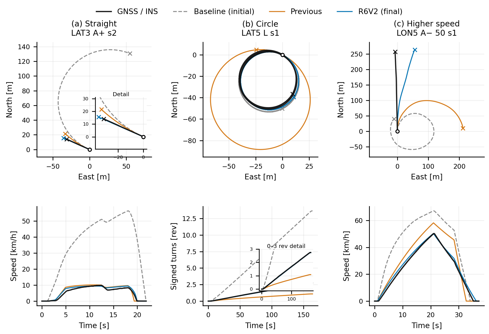

# Can Multimodal LLMs Be Real-World Engineers?

Seunghwan Shim · Hanyang University

[Dataset](https://huggingface.co/datasets/ShimSeungHwan01/2026NLP_simulation_research) · [Simulator](https://github.com/simseunghwan90/NLP_2026_ShimSeungHwan/releases) · [Reproduction](docs/REPRODUCIBILITY.md) · Paper: 공개 예정

언어모델 에이전트가 실차 측정값을 해석하고 차량 시뮬레이터를 보정하는 과정을 연구한다. 이 저장소는 사람의 감독 아래 수행한 A1 차량 실험의 분석 코드와 세 모델(Baseline, Previous, R6V2)의 비교 자료를 제공한다.



28개 개발 구간 중 동일 입력으로 비교한 7개 구간을 보고한다. 이 자료는 보정과 모델 선택에 사용했으며, 독립 평가 데이터는 포함하지 않는다.

## 표와 그림 재현

Linux와 Python 3.10을 사용한다. 데이터 다운로드 → 표·그림 생성 순서로 실행한다. 데이터가 이미 `../dataset`에 있으면 다운로드 명령을 생략한다.

```bash
# 터미널 1 · 이 저장소 루트
python3.10 -m venv .venv
.venv/bin/python -m pip install -r requirements.txt huggingface_hub
.venv/bin/hf download ShimSeungHwan01/2026NLP_simulation_research --repo-type dataset --local-dir ../dataset
.venv/bin/python scripts/reproduce.py --dataset ../dataset --output results/hw2
```

결과는 `results/hw2/`에 저장한다. 재실행할 때는 비어 있는 출력 경로를 지정한다. 이 명령은 저장된 재생 결과로 표와 그림을 생성하며, Unreal을 실행하지 않는다.

## 자료 안내

- [재현 안내](docs/REPRODUCIBILITY.md): 출력 파일, 환경, seed와 검증 범위
- [코드 구성](docs/STRUCTURE.md): 분석 코드, 모델 설정, 보정 기록
- [시뮬레이터](simulator/README.md): UE4.27 프로젝트와 Release 구성
