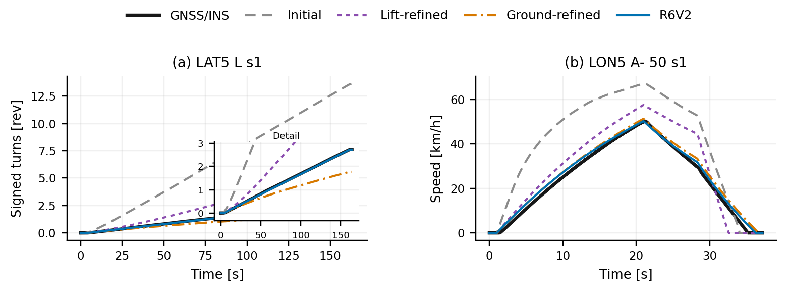
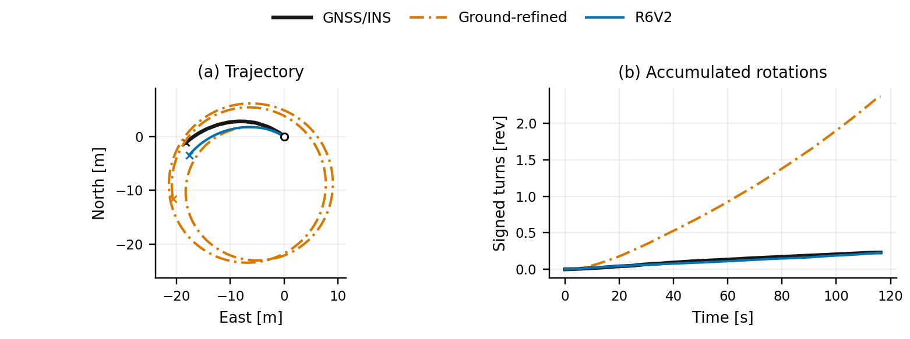

# Can Multimodal LLMs Be Real-World Engineers?

Seunghwan Shim · Hanyang University

[Dataset](https://huggingface.co/datasets/ShimSeungHwan01/2026NLP_simulation_research) · [Simulator](https://github.com/simseunghwan90/NLP_2026_ShimSeungHwan/releases/tag/v0.1.0) · [Reproducibility](docs/REPRODUCIBILITY.md) · Paper: 공개 예정

멀티모달 언어모델 에이전트가 실제 차량의 실험을 설계하고, 측정 결과를 해석해 시뮬레이터를 개선할 수 있는지 살펴본다. A1 전기 레이싱 차량을 대상으로 리프트 시험과 K-City 주행 시험을 수행하고, 기록된 제어 입력을 시뮬레이터에 재생해 보정 단계별 차량 응답을 비교한다.

## 방법

Claude Code는 시험 동작과 제어 입력을 설계하고 시험 프로그램을 작성한다. 사람은 차량의 운용 조건을 확인하고 실험과 데이터 수집을 감독한다. 먼저 구동륜을 들어 올려 가속·타력·제동 응답을 측정하고, 이후 지상에서 직진·원선회·가감속 시험을 수행한다. 차량 명령과 상태는 CAN 및 ROS 2 bag으로, 실제 움직임은 GNSS/INS로 기록한다.

Codex는 이 기록과 응답 그래프를 분석해 오차의 원인에 대한 가설을 세우고, Unreal Engine 4.27·FSDS·PhysX 기반 시뮬레이터의 파라미터와 C++ 구현을 수정한다. 수정한 모델에 같은 입력을 다시 재생해 속도, 시간별 위치, 종점, 누적 회전수를 비교한다. 이 과정을 반복하면서 사람은 후보 채택 기준과 움직임 해석에 대한 피드백을 제공한다.

논문은 다음 네 단계의 모델을 비교한다.

| 모델 | 보정 내용 |
|---|---|
| Initial | 차량 사양과 근사 파라미터로 구성한 초기 모델 |
| Lift-refined | 11월 14일 리프트 측정에 따른 스로틀–토크 관계, 회전 관성, 타력 감속 보정 |
| Ground-refined (`trial03`) | 11월 20일 지상 측정에 따른 조향 영점·비선형 변환·응답과 가속·제동·저항 보정 |
| R6V2 | 사람의 피드백 이후 궤적 형상과 누적 회전수를 함께 평가하며 추가 보정한 모델 |

비교에는 직진 3개, 원선회 1개, 가속–타력–제동 1개, 재배치 주행 2개로 구성된 **7개 구간 × 4모델**을 사용한다. 각 구간의 기록된 입력과 초기 조건을 맞추며, 초기화 이후에는 실측 상태를 주입해 궤적을 보정하지 않는다.

## 단계별 차량 응답

논문 Figure 1. 왼쪽은 원선회(LAT5)의 누적 회전수, 오른쪽은 가속–타력–제동(LON5)의 속도이다. 지상 보정과 후속 보정을 거치며 실측 응답에 가까워진다. LAT5의 Initial 결과는 바퀴 접지 검사를 통과하지 못한 진단용 결과이다.

Ground-refined에서 R6V2로 보정한 뒤 LAT5의 위치 RMSE는 37.60 m에서 2.92 m로, 회전수 오차는 0.969회에서 0.011회로 줄었다. LON5의 속도 RMSE는 Initial의 5.244 m/s에서 R6V2의 0.462 m/s로 줄었다.

## 사람의 피드백 이후 보정

종점 오차만으로는 주행 형상이나 불필요한 회전을 충분히 설명하기 어려웠다. 사람의 피드백 이후 에이전트는 후보 기각 기준을 조정하고 궤적 형상, 진행 과정, 누적 회전수를 함께 검토했다.

논문 Figure 2. 재배치 구간 MOVE LAT3 A+ s2에서 위치 RMSE는 17.73 m에서 1.69 m로, 회전수 오차는 2.134회에서 0.005회로 줄었다. 이 비교에는 추가 모델 수정과 평가가 함께 포함되므로 사람의 피드백만의 효과를 분리한 실험으로 해석하지 않는다.

모든 구간이 같은 수준으로 개선되지는 않았다. R6V2도 MOVE LAT3 A+ s1에서 위치 RMSE 31.33 m와 회전수 오차 1.139회가 남았다. 비교 자료는 보정과 모델 선택에 사용한 개발 데이터이며, 독립 주행 데이터에 대한 평가는 후속 과제로 남는다.

## 코드와 데이터

| 자료 | 위치 |
|---|---|
| 최종 논문의 그림·수치·모델 설정 | [paper_results/](paper_results/README.md) |
| CAN·rosbag·GNSS/INS·DBC·보정 기록과 4모델 재생 결과 | [Hugging Face Dataset](https://huggingface.co/datasets/ShimSeungHwan01/2026NLP_simulation_research) |
| Unreal 프로젝트와 초기 모델 아카이브 | [Simulator Release](https://github.com/simseunghwan90/NLP_2026_ShimSeungHwan/releases/tag/v0.1.0), [구성 안내](simulator/README.md) |
| 설치와 논문 결과 생성 명령 | [재현 안내](docs/REPRODUCIBILITY.md) |
| 분석 코드와 보정 과정의 구성 | [코드 안내](docs/STRUCTURE.md) |
