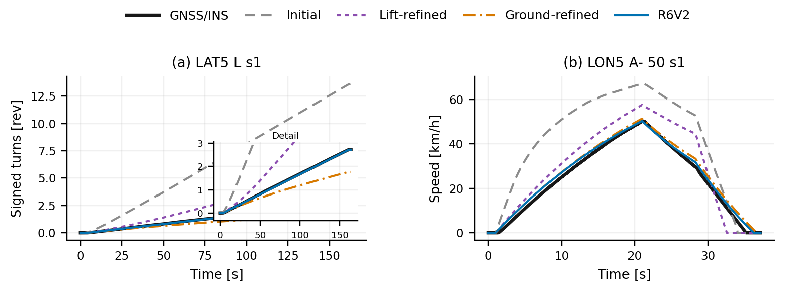

# A1 Simulator

[Download](https://github.com/simseunghwan90/NLP_2026_ShimSeungHwan/releases/tag/v0.1.0) · [Dataset](https://huggingface.co/datasets/ShimSeungHwan01/2026NLP_simulation_research)

A1 전기 레이싱 차량의 응답을 모델링하는 Unreal Engine 4.27·FSDS·PhysX 기반 시뮬레이터이다. 기록된 조향·가속·제동 입력을 재생하고 차량의 속도와 궤적을 GNSS/INS 측정과 비교한다. 에이전트는 이 차이를 분석해 구동계, 조향 변환, 제동과 저항의 파라미터 및 C++ 구현을 수정했다.

논문은 Initial → Lift-refined → Ground-refined (`trial03`) → R6V2의 보정 과정을 다룬다. 아래 그림은 원선회 누적 회전수와 가속–타력–제동 속도를 비교한 것이다. Initial의 원선회 결과에는 접지 검사 실패가 있다.

## 프로젝트 구성

이 폴더에는 소스와 설정을 제공한다. Content·플러그인·기존 Linux 모듈을 포함한 프로젝트는 Release에서 받는다. 아카이브 이름은 실험 당시 이름을 사용한다.

| 프로젝트 | 보관 내용 |
|---|---|
| [lat3_three_models_20261122](projects/lat3_three_models_20261122/) | 앞선 Baseline·Previous 비교에 사용한 프로젝트 |
| [r5_creep_viscous_20261122](projects/r5_creep_viscous_20261122/) | R6V2 비교에 사용한 프로젝트 |

Release에는 2026년 11월 10일 초기 모델 아카이브도 포함한다. 최종 논문의 네 모델 설정은 [모델 색인](../paper_results/model_index.json), 실제 실행별 결과와 출처는 데이터셋의 `four_stage_comparison/replay_index.json`을 따른다. `Previous`와 `Ground-refined`는 다른 모델이다.

## 사용 환경

UE4.27을 별도로 설치해야 한다. 배포본은 에디터용 프로젝트이며, 엔진과 빌드 캐시는 포함하지 않는다. 네 모델 각각의 독립 실행 패키지는 제공하지 않는다. 확인 필요: 새 머신에서의 빌드와 네 모델 전체 입력 재생 절차.

저장된 결과에서 논문 그림과 표를 생성하는 명령은 [재현 안내](../docs/REPRODUCIBILITY.md)에 있다.
